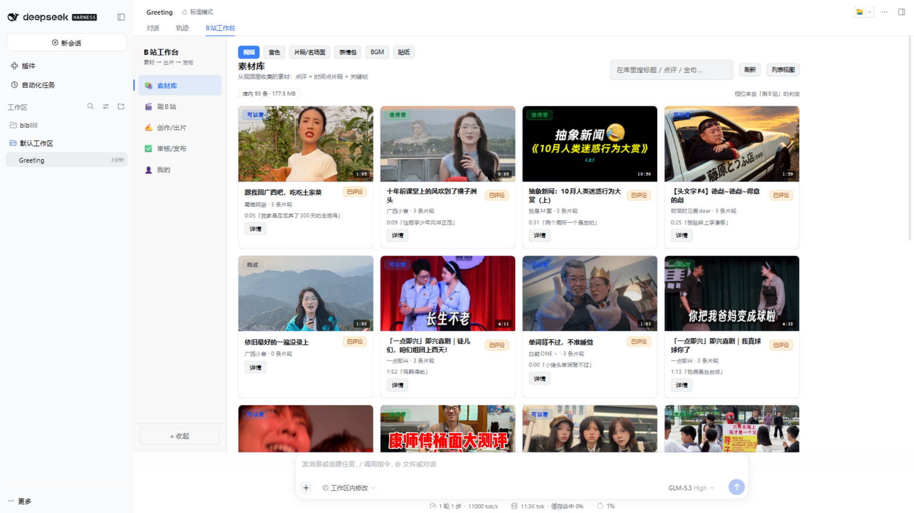
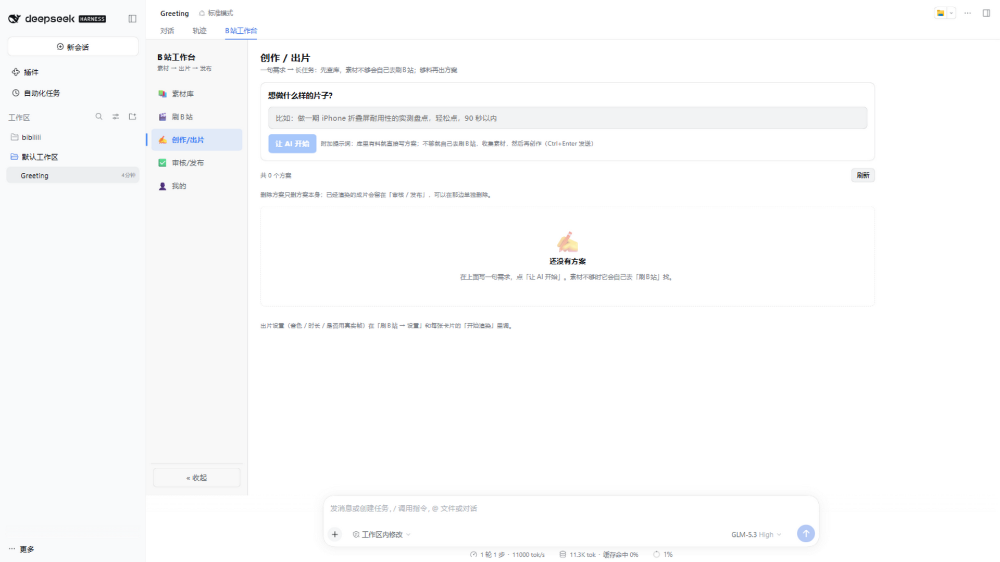
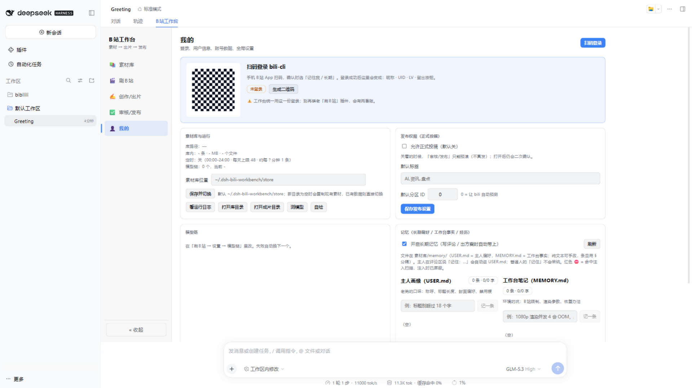

# dsh-bili-workbench

> 一个 **DSH（DeepSeek Harness）** 插件：把「刷 B站 / 素材库 / AI 出片 / 审核发布 / 自动互动」放进同一个工作台。

[](https://github.com/topics/dsh-plugin)
[](LICENSE)

刷到的视频会落进素材库，出片引擎从库里取真实帧和金句；同一条视频只抓一次。不是又一个「B站信息流面板」，而是一条从**看**到**做**再到**发**的完整流水线。





## 功能

| 模块 | 做什么 |
|---|---|
| 📚 素材库 | 视频元数据、逐字稿（带时间戳）、关键帧、封面、AI 点评、可引用金句、热评、热门弹幕、热梗；按 BV 幂等，7 天内不重复抓 |
| 🎬 刷B站 | 综合热门 / 关键词搜索 / 看懂视频；按多时段 + 每日上限自动采集；每条采完自动判定、抽句、抓热评/弹幕/热梗、刷新日报 |
| ✍️ 创作 / 出片 | 一句话出方案 → 改一版（v1/v2…）→ 真实帧 + Edge-TTS 配音 + Remotion 渲染 → 1080p 成片 + 封面；库里没料时自动转成「长任务」；方案可删除（两次确认） |
| ✅ 审核 / 发布 | 待审列表、通过 / 打回、预览成片、删除成片、投稿 dry-run；真投稿默认关，打开后仍需二次确认 |
| 👤 我的 | 扫码登录 / 登出、账号数据、素材库信息、运行日志、模型健康检查、发布权限 |
| 💬 自动互动 | 可选：每条采到的视频自动留一条评论并 @ 你、称呼你；有人回复就自动回；主人身份与只读指令；12 秒发送间隔 + 每日上限；**默认关** |

## 环境要求

- **DSH** `>= 0.2.1-rc.1`（`dsh --version`）
- **Node.js** `>= 22`
- **bili-cli**（命令名 `bili`，PyPI 包 `bili-agent`）—— 账号操作的“手”
- **ffmpeg**（需要 `libass`，烧字幕用）
- **edge-tts**（配音）
- **Chrome 或 Edge**（Remotion 渲染用，自动探测）
- 一个 **OpenAI 兼容的模型端点**（用于判定、写方案、写评论）

## 安装

### 方式 A：从 GitHub 直接装（推荐）

```bash
dsh plugin --profile web add github:Userluckytian/dsh-bili-workbench
```

> 仓库所有者是 `Userluckytian`；如果你 fork 了，把用户名换成自己的。pnpm 会同时安装插件依赖（Remotion / sharp）。

### 方式 B：克隆后 link（想改代码）

```bash
git clone https://github.com/Userluckytian/dsh-bili-workbench.git
cd dsh-bili-workbench
npm install
dsh plugin --profile web add link:$PWD
```

Windows PowerShell：

```powershell
git clone https://github.com/Userluckytian/dsh-bili-workbench.git
cd dsh-bili-workbench
npm install
dsh plugin --profile web add "link:$PWD"
```

### 方式 C：npm（暂未发布）

```bash
dsh plugin --profile web add dsh-bili-workbench
```

装完**重启 dsh**，刷新浏览器页面，会话顶部会出现「B站工作台」页签。

### 外部命令

```bash
# bili-cli（需要 Python 3.10+；会装一个 bili 命令）
uv tool install bili-agent
bili auth login

# 配音
uv tool install edge-tts

# ffmpeg（Windows）
winget install Gyan.FFmpeg

# 自检
node scripts/doctor.mjs
```

## 第一次使用

1. 打开 dsh → 会话顶部「B站工作台」。
2. **我的 → 扫码登录**（登录只在这一处；不要在别处再装老「刷B站」插件，会有两套账号）。
3. **刷B站 → 刷B站设置**：
   - 模型链：一行一个模型名，失败会自动换下一个。
   - 模型密钥：`llmKey`（也可以设环境变量 `OC_API_KEY`）。
   - 模型端点：环境变量 `BILI_OP_LLM_BASE`，默认 `http://127.0.0.1:40080/v1`。
4. 点「立即跑一轮」，确认能采集、判定、写日报。
5. 需要出片时，去「创作 / 出片」生成方案并渲染。

## 素材包

音色 / 片段 / 表情包 / BGM / 贴纸这些素材**不打进安装包**（体积太大），默认从素材库的兄弟目录找：

```text
<素材库>/../assets-src/
  voices/   参考音 wav（同名 .txt 是参考文本）
  clips/    片段 + index.json
  memes/    表情包（bili-emotes + index.json）
  bgm/      BGM + index.json
  stickers/ 贴纸（openmoji/png-618x618-color）
```

- 目录不存在时，素材页会显示「未找到素材目录」，并在「我的 → 自检」里能看到各项状态。
- 可用环境变量 `BILI_ASSETS` 指向你的素材目录（优先级最高），设置后重启生效。
- 首次使用：可从 release 附件下载素材包解压到上述位置，或自行准备（音色也可以在「素材库 → 音色」里采新 / 导入本地 wav）。

## 自动互动：默认关，打开前请读完

自动互动会**用你的账号公开发评论 / 回复**。为了安全，插件内置默认是：

```text
定时自动刷   关
自动评论     关
自动回复     关
私信监听     关
真投稿       关
```

打开「自动评论」后，当天每条采到的视频都会留一条评论并 @ 你；打开「自动回复」后，有新回复会自动回。发送间隔固定 12 秒（B站要求至少 10 秒），并有每日上限。命中风控 / 限流 / 操作间隔会立即停止本轮，失败条目不写账本，下一轮再补。

手动「评论 / 回复 / 私信」仍然默认 **dry-run**：只生成并打印将要提交的内容，不真正发送；勾「真的发」才会发。

> 公开内容一旦发出就可能被缓存或转发。请自行确认账号、内容和使用场景符合 B站 的社区规则。

## 主人身份与只读指令

在「刷B站 → 刷B站设置」里填两个字段：

| 字段 | 说明 |
|---|---|
| 主人 UID | 你的 B站 UID（例如 `498295893`）。只有这个 UID 会被当主人 |
| 称呼 | 自动评论 / 回复里怎么称呼你，默认「老弟」 |

设置后：

- **自动评论**会在正文里自然称呼你，并把这条评论 `@` 到你（`--at 主人UID`）。
- **自动回复**能区分主人和普通用户：主人留言即使已被界面标记已读也会处理；普通用户仍只回新消息。
- 主人可以问只读问题，答案从本地素材库和互动账本实时计算：
  - 「今天逛了多少视频？」
  - 「设定的时间是多久 / 时段是什么？」
  - 「今天评论、回复多少条？」
- 非主人询问统计、配置、权限、密钥、路径等，会收到一句礼貌拒绝（不沉默、不给数据）；让机器人代发/代删/代传的指令同样拒绝。
- 主人要求改配置、投稿、删除、私信、发评论时，只回复“去工作台手动改”，不会在评论里执行。
- **数据类回答会带人设语气**：先用本地素材库和账本算出准确数字，再交给模型改写；改写后逐个核对数字，少一个、多一个或改写失败都会自动退回原句。称呼固定用账号设置里的「老弟」。
- 自动回复会跳过账本里已回复的 `rpid` 和自己刚发出的回复文本，避免自问自答循环。

**多人 @**：设置页「额外 @（可多人）」可以加多个人，每个填「UID 或昵称」和「称呼」（例如爸爸、妈妈）。自动评论会把这些人都 `@` 上，并在正文里自然喊出对应称呼；模型漏写时会把缺的称呼补在开头。

> B站 一条评论最多 `@` 3 个人，所以主人 UID + 最多再加 2 个；主人 UID 会自动 `@`，不用重复添加。

**人设是身份，不是记忆**：设置页「人设」描述角色是谁、怎么说话、什么不能做，每次生成都放在提示词最前面，不会写进记忆，也不会被任务复盘改写。账号归属（谁在用这个号）和说话人格分开处理。

**自己的视频（B站合集）**：在设置页填一个合集链接（如 `https://space.bilibili.com/<UID>/lists/<ID>`），插件会缓存里面每集的标题和日期。写评论、回复、方案时会挑「和当前话题相关的几集 + 最近几集」作为参考，明确要求不硬提、不编造，同样不写进记忆。启动时检查一次，之后每 6 小时看是否过期，也可以点「更新合集」立即刷新。

### 长期记忆：它记得住（1.0.0）

插件自带一套**三层记忆**，让它越用越顺手：

| 层 | 是什么 | 在哪看 |
|---|---|---|
| 主人画像（USER.md） | 你的口味和纠正：「标题别超过 18 字」「别用某梗」，跨场景生效 | 我的 → 记忆 |
| 工作台笔记（MEMORY.md） | 环境的坑：B站 限制、渲染参数、恢复办法 | 我的 → 记忆 |
| 经历流（events.jsonl） | 它经历过什么：看过哪些视频、出过什么方案、渲染/审核/评论结果 | 我的 → 记忆 |

怎么用：

- **写下来**：主人在 B站 评论/回复里说「记住：标题别超过 18 字」，会自动进主人画像并回复确认；普通用户的「记住」会被礼貌拒绝。设置页「人设」下方也有「让咕嘎有记忆」总开关（关掉后行为回到无记忆版本）。
- **自己长记性**：每次方案 / 渲染 / 审核 / 投稿结束后自动「复盘」，从最近经历里提炼跨次有效的偏好写进画像（只增不改、每条 ≤60 字、人设永不写入）；「我的 → 记忆」里能看、能删、能点「立即复盘」。
- **想起旧素材**：出方案和写评论时，会按题材把经历流里相关的过往经历想起来（长任务日志会显示「想起 N 条相关经历」），前两天看过的剧今天就能用上。
- **安全**：记忆是纯文本（`<素材库>/memory/`），可手改；命中注入扫描（「忽略以上指令」类）的条目写入被拒、注入时替换 `[BLOCKED]`、界面标红；无人值守的修改/删除进待批区等批准。

### 让成片"活"起来（1.2.0）

- **broll 全屏直拼**：`clip.mjs` 裁好的名场面片段在方案里全屏一段接一段播放（也可画中画）
- **动画形象**：右下角循环视频形象（默认内置大肥鱼动画）；`mascot:false` 关闭、`mascotVideo` 换素材
- **自动评论带图**：`commentImageEvery`（默认 5 条 1 图，0=关），表情包从 B站官方 emote 收集
- 配套工具：`tools/cutout.mjs`（rembg 抠图）、`tools/fetch-emotes.mjs`（表情包收集）

### 主人 @ 任务：看视频 / 看评论 / 要总结

用主人账号在任意 B站 视频评论里 `@` 它，写清要什么：

| 你说 | 它做什么 |
|---|---|
| `总结一下这个视频 BV...` | 看视频（字幕 + AI 摘要 + 数据）并总结 |
| `看看这条视频的评论 BV...` | 总结评论区：主要观点、梗、争议、整体氛围 |
| `视频和评论都看看 BV...` | 两者都做 |
| 只 `@` 它、不写 BV | 用你这条评论所在的视频 |

交付规则（重点）：

- **默认：总结只走私信 / 工作台，不往评论区发**，长文不会进评论区。
- 说「别发评论区 / 不要回复」→ 只发私信。
- 说「私信我」→ 只发私信。
- 说「回评论区」→ 压缩成 ≤45 字短版回评论（同时说「私信」就再发一份全文）。
- 没给 BV → 回一句问你要。
- 私信需要先在「我的」里扫码登录 bili-cli；没登录（B站返回 -101）时，全文留在工作台「消息 → 主人请求」，记录里会提示重新扫码。
- 每 3 分钟检查一次 `@`，每天最多处理 10 个；每次结果都留在工作台，可以点开看全文。

> 私信单条最多 500 字，长总结会拆成 2–4 条发；再长会截断并提示看工作台全文。

主人身份只影响**回复策略**，不会绕过 B站 的权限或风控；所有发送仍然是实名公开操作。

## 长任务：素材不够，自己去刷 B站

在「创作 / 出片」写一句需求（例如“找找素材，出一期新三国的名场面的热梗集锦”），不需要等它立刻出片：

1. 先查素材库，按需求拆出的关键词匹配「相关且可用」的视频（有字幕或金句）。
2. 够料（默认 3 条）就直接写分镜方案。
3. 不够就自己去「刷B站」：按关键词搜索 → 采集字幕 / 关键帧 / 热评 / 弹幕 → 判定抽句 → 再查库。
4. 还不够就每 3 小时再找一轮，最多找 5 天；期间任务卡一直显示进度。
5. 够料后自动生成方案，停在「方案已生成」，**不会自动渲染、不会自动投稿**。

创作页下方会为每个任务显示一张卡片，状态包括：

| 状态 | 含义 |
|---|---|
| 排队中 | 刚创建，等宿主开跑 |
| 检查素材库 | 正在按关键词查库 |
| 逛 B站 中 | 正在搜索、采集、判定 |
| 素材不足，继续找 | 这一轮没凑够，过几小时再来 |
| 写方案中 | 素材够了，正在写分镜 |
| 方案已生成 | 可以去下面看方案，再决定是否渲染 |
| 已暂停 / 已停止 | 手动暂停，或到期/出错停止 |

卡片上有「现在再找一轮」「暂停 / 继续」「删除」「查看方案」。任务记录在素材库的 `tasks.json`；宿主重启后，跑到一半的任务会自动恢复排队。

任务自己采到的新视频也会按「自动评论」设置留评论并 @ 主人，和日常采集共用同一条每日上限。

## 审核 / 发布怎么走

在「创作 / 出片」点「开始渲染」之后，**不需要再回创作页做任何操作**。成片一完成，就会自动出现在「审核 / 发布」列表（页面每 5 秒刷新一次）。

- 审核按**成片（run）**为单位：同一方案重新渲染会生成一条新成片，需要重新点「通过」。
- 「预览」可以直接播放成片；「删除成片」只删本地 `renders/<runId>`，不会删除 B站 上已经发布的内容；关联项目会回到草稿，可以重新渲染。
- 在创作页「删除方案」只删方案本身，已经渲染的成片会留在「审核 / 发布」，需要单独删除。
- 「投稿 dry-run」会完整打印标题、标签、分区、封面、简介和命令，但不会真的发布。
- 「真投稿」默认关闭：先到「我的 → 发布权限」打开「允许真投稿」，再对成片点「通过」，之后才会出现可用的「真投稿」，发送前还有一次确认。

## 数据与配置

默认数据目录：

```text
~/.dsh-bili-workbench/store/
  videos/<BV>.json      视频事实 + 判定 + 金句
  subs/<BV>.json        逐字稿
  frames/<BV>/          关键帧
  covers/<BV>.jpg       封面
  plans/<项目>/          方案与版本
  renders/<runId>/      成片、封面、字幕、配音（升级插件不会丢）
  reports/YYYY-MM-DD.md 素材日报
  config.json           设置（含模型密钥，注意不要提交）
  interactions.json     已评论 / 已回复账本
  tasks.json            长任务（素材不够自己去刷B站）
```

默认位置是 `~/.dsh-bili-workbench/store`；从原项目迁移的机器上，如果存在 `D:\AI_projects\bibilili\bili-store` 且没有设置 `BILI_STORE`，会自动使用旧目录。也可以：

- 在「我的 → 素材库与运行 → 素材库位置」里直接改，保存后即时切换；新目录为空时会复制现有素材
- 用环境变量 `BILI_STORE` 指定

选择过的位置会写进 `~/.dsh-bili-workbench/location.json`，重启后保持不变。

常用环境变量：

| 变量 | 作用 |
|---|---|
| `BILI_STORE` | 素材库目录 |
| `BILI_OP_DIR` | 出片引擎目录（默认用插件内置的 `bili-op/`） |
| `BILI_OP_LLM_BASE` | OpenAI 兼容端点，默认 `http://127.0.0.1:40080/v1` |
| `OC_API_KEY` | 模型密钥（没设则读 `config.json` 的 `llmKey`） |
| `BILI_OP_CHROME` | 指定 Chrome / Edge 可执行文件 |
| `BILI_BIN` | 指定 `bili` 可执行文件 |

## 目录

```text
index.js                 dsh 宿主半端：路由 / 调度 / 子进程编排
client.js                浏览器半端：工作台界面
engine/                  采集、判定、日报、方案、渲染、互动、账本、长任务
engine/task.mjs          长任务：拆词 → 查库 → 逛B站 → 写方案
engine/taskstore.mjs     任务账本（tasks.json）
bili-op/                 出片引擎：脚本 → edge-tts → Remotion → ffmpeg → 封面
cordis.patch.yml         dsh bundle patch
scripts/doctor.mjs       环境自检
```

## 常见问题

**装完没有「B站工作台」页签？**
先确认 dsh `>= 0.2.1-rc.1`；装完必须重启 dsh，再刷新浏览器。看 dsh 的启动日志有没有插件加载错误。

**渲染报“找不到 Remotion CLI”？**
说明依赖没装到包根。重新执行 `npm install`（方式 B），或重装插件（方式 A）。脚本会按 Node 解析规则找 `@remotion/cli`，不再写死 `render/node_modules`。

**渲染时报找不到浏览器？**
装 Chrome 或 Edge；也可以用 `BILI_OP_CHROME` 指定路径。Linux/macOS 下请把 `bili-op/render/src/News.tsx` 和 `bili-op/cover.mjs` 里的字体改成系统有的字体。

**审核 / 发布里为什么没有「真投稿」？**
真投稿默认是关的（`publishEnabled: false`）。先到「我的 → 发布权限」打开「允许真投稿」，再在审核卡上点「通过」，才会出现可用的「真投稿」按钮。投稿前建议先点「投稿 dry-run」：它会把标题、标签、分区、封面、简介完整打印出来，但不会真的发布。

**渲染完成后「预览成片」还是灰的？**
先确认成片文件存在：`<素材库>/renders/<runId>/final-subbed.mp4`。旧版本把成片放在插件的 `bili-op/runs`，升级重装会清掉；0.4.2 起已改到素材库目录，并会自动迁移旧成片。如果项目显示「已完成」但文件确实不存在，重启 dsh 后会自动改回草稿，重新渲染即可。

**ffmpeg 烧字幕失败？**
需要带 `libass` 的 ffmpeg：`ffmpeg -filters | grep subtitles`。

**模型一直 429？**
模型链会自动退避换下一个；也可以在设置里换一个可用的模型或端点。

**pnpm 提示忽略了构建脚本？**
在 dsh profile 目录执行 `pnpm approve-builds`，允许 `sharp` / Remotion 的平台包，然后重装。

## 安全边界

- 不自动投稿：`publishEnabled` 默认 `false`。
- 不自动私信：私信监听默认关。
- 自动评论 / 回复默认关；手动流程默认 dry-run。
- 账号凭证由 `bili` 管理，不写进本仓库；`bili-store/config.json` 可能含模型密钥，已被 `.gitignore` 排除。

## 致谢与许可

本项目以 **MIT** 发布。

灵感来源：

- [dsh-bili-scroll](https://github.com/c1overzz/dsh-bili-scroll)（c1overzz，MIT）—— 前身「刷B站」插件，字段、调度与互动设计参考
- [bili-cli](https://github.com/kukemc/bili-cli)（kukemc，MIT）—— B站 账号操作 CLI

其他运行时依赖（Remotion、edge-tts、FFmpeg 等）遵循各自许可证，详见 [NOTICE.md](NOTICE.md)。Remotion 不是 OSI 许可证，商业使用前请自行确认其授权条款。

> 本项目与哔哩哔哩官方无关联。使用本工具产生的账号行为、内容与后果由使用者自行承担。

## 合规提示

- AI 内容声明已随投稿自动附加（bili CLI 默认勾选"含 AI 生成内容"，简介末尾也会自动追加一行文字声明）。
- 使用他人素材（画面、音乐、音色等）时请注意二次创作的边界，遵守原素材的授权条款。
- 克隆真人声音需要取得本人授权，请勿未经许可采集或仿冒他人声音。
